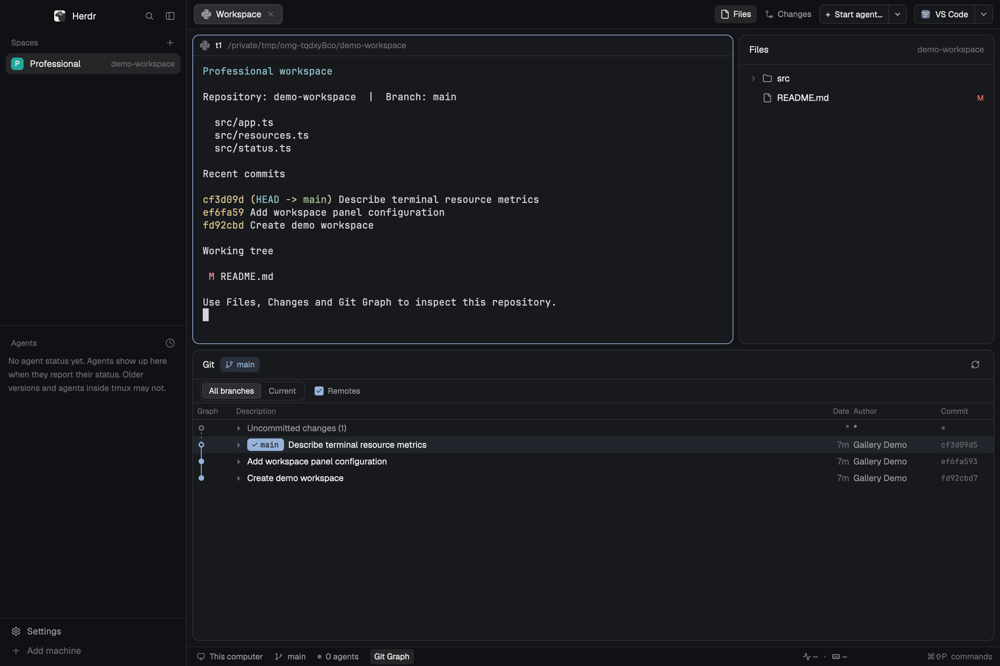

# oh-my-herdr

English | [简体中文](README.zh-CN.md)

A workspace layout for Herdr Desktop: Spaces and Agents on the left, Agent and repository launchers at the top right, Files/Changes on the right, and Git Graph, CPU, and memory at the bottom.



Supports Herdr Desktop 0.1.15, not Herdr TUI. Bundle version: 0.4.0.

## Installation

Requires macOS 13.5 or later and Herdr Desktop 0.1.15, launched at least once. The `herdr-app` command must be available in your terminal. Installing a release ZIP does not require Node.js, Rust, Cargo, Git, or Xcode, does not change the system PATH, and does not use sudo.

Download the 0.4.0 ZIP for your architecture and `SHA256SUMS` from [Releases](https://github.com/OiAnthony/oh-my-herdr/releases): choose `darwin-arm64` for Apple Silicon or `darwin-x64` for Intel. If the release is not yet available, a maintainer must build it using the [development guide](docs/development.md). GitHub's automatically generated Source code ZIP does not include the runtime or helper and cannot replace a release package.

The following example assumes Apple Silicon and downloads in `~/Downloads`. On Intel, replace `arm64` with `x64` in the filenames:

```sh
cd ~/Downloads
shasum -a 256 oh-my-herdr-0.4.0-darwin-arm64.zip
# Compare the output with the matching entry in SHA256SUMS before extracting.
unzip oh-my-herdr-0.4.0-darwin-arm64.zip
cd oh-my-herdr-0.4.0-darwin-arm64
./install.sh --switch
```

The installer uses the bundled `runtime/node` and prebuilt resource sampler to install the layout and eight Mods, merge keybindings, and run `herdr-app check`. On success, it prints `8 mods checked`; `--switch` then explicitly activates the layout. Without `--switch`, the current layout stays unchanged. No mode restarts Herdr. `--dry-run` performs read-only preflight checks and prints commands. A damaged package, architecture mismatch, missing Herdr, or uninitialized app home causes failure before configuration writes. The installer does not invoke system Node, download dependencies, or compile on the user's machine.

The ZIP is unsigned and not notarized. After a browser download, macOS Gatekeeper may block Node or the helper. Verify the source and checksum, then follow the system prompt in **System Settings → Privacy & Security** to allow the blocked program manually and retry. If macOS still refuses to run it, stop the installation. The installer does not remove quarantine or disable Gatekeeper, and it does not promise a prompt-free installation. Checksums detect corruption; they are not an independent signature.

Toolchain-free installation does not remove runtime dependencies: Git Graph and other Git features still need Git; editors and Agents must be installed separately. This bundle does not include Git or install Command Line Tools.

Mods are trusted code. Review the source before installing.

## Activation

```sh
herdr-app do layout.switch '{"name":"oh-my-herdr"}'
```

To activate the layout during installation, use:

```sh
./install.sh --switch
```

`herdr-app check` verifies deployment and initial loading only. Confirm the layout and interactions in the application window.

## Quick start

The two launchers at the top right start an Agent and open a repository. Click the main button to use the default, the arrow to choose an option, or a row's star to set the default.

| Shortcut | Action |
| --- | --- |
| `⌘⇧A` | Start the current machine's default Agent |
| `⌘G` | Open the current repository or directory in the default app |
| `⌘⇧E` | Show and focus Files; hide it if already focused |
| `⌘⇧G` | Toggle Changes; press twice within 300 ms to toggle Git Graph |
| `⌘W` | Close the current pane; closing the last pane also closes the tab |
| `⌘T` | Open a new terminal |
| `⌘⇧P` | Open the command palette |

Click the CPU or memory reading at the far right of the footer to open Task Manager. Its tabs share a row with the `Herdr / System` selector, which controls Tree, Processes, and Ports. Herdr includes managed terminals and their OS descendants; System shows each machine's processes and TCP listeners. Each opening returns to Herdr Tree, locates the current pane, and expands it. Changing scope preserves the filter and sort order; changing tabs preserves the scope. The Tree toolbar expands all, collapses all, or locates the current pane. Locate also returns to Herdr Tree, clears the filter, expands the target and its ancestors, and scrolls to the target row. Machine, sampling, and coverage details are available on hover rather than in a persistent note below the summary. Type to filter, separating terms with spaces. The first Esc clears the filter; the second closes the popover. Tree shows listening ports by default. Tree and Ports scan listeners every 5 seconds; Processes and a closed popover stop those scans. Searching does not widen the scope. Footer readings always show Herdr-managed resources. The System summary totals readable processes; it is not total system-used memory. Closing the popover stops system-wide collection.

Footer values use at most three digits, excluding the decimal point, percent sign, and unit: for example, `10.0%`, `100%`, `1.60k%`, and `12.4 GB`. `k%` means thousands of percentage points; 100% CPU still represents one core. The panel and tooltips retain detailed formatting. Compact, fixed-width footer slots keep monospaced values left-aligned next to their icons, so updates do not move adjacent elements. The Task Manager summary shows CPU and Memory on two lines at the left, while Tree's memory trend fills the remaining width on the right. The actual memory metric, such as Footprint, remains in the summary tooltip.

`⌘W` terminates the terminal in the pane. The previous `⌘⇧W` close-pane binding is removed.

## Configuration

The default app home is `~/.config/herdr-app`. To use a different directory, first run `export HERDR_APP_HOME=/path/to/app-home`. Neither the path nor its parent directories may contain symbolic links.

To register OMP, add this entry to `programs.json`:

```json
{
  "programs": {
    "omp": {
      "name": "OMP",
      "run": ["omp"],
      "icon": "mods/agent-launcher/icons/omp.svg",
      "tint": false
    }
  }
}
```

Configure Open With apps in `mods/open-with/apps.json`. Each entry requires `id` and `title`; regular apps also require a macOS `bundleId`. The list supports up to 20 entries. If a Core machine name differs from its SSH Host, add a mapping such as `{"my-machine":"my-ssh-alias"}` to `mods/open-with/hosts.json`: keys are machine names and values are SSH Hosts.

On macOS, installation exports icons from locally installed VS Code, Finder, Zed, and IntelliJ IDEA into the app home's `data/open-with-icons/` cache. Extracted artwork is not included in the source repository or release package. Apps that are not installed keep generic icons; Cursor and Sublime Text keep their bundled SVGs. Explicit icons in a personal `apps.json` take precedence. Run the installer again to refresh the cache; uninstalling preserves this local cache.

## Updating and uninstalling

Download the new version's ZIP for your architecture, verify its `SHA256SUMS`, extract it to a new directory, and run `./install.sh` there. For example, to reinstall 0.4.0 without switching layouts:

```sh
cd ~/Downloads/oh-my-herdr-0.4.0-darwin-arm64
./install.sh
./install.sh --check
```

No system Node is required. The installer does not add an update service or automatically download a new version from an older directory. Keep the extracted directory for checks and uninstallation.

The layout was previously named `Professional` and is now consistently named `oh-my-herdr`. Updates remove unchanged old layout files recorded in the ownership manifest; unowned or locally modified files with the same names are not forcibly overwritten. If the old layout is active, switch to the built-in `main` layout first, then activate the new layout after updating. Personal state for the old name, such as dimensions and visibility, is preserved but not migrated to the new name.

Before uninstalling, switch back to a built-in layout. If you use a custom app home, use the same `HERDR_APP_HOME` for every command below:

```sh
herdr-app do layout.switch '{"name":"main"}'
cd ~/Downloads/oh-my-herdr-0.4.0-darwin-arm64
./install.sh --uninstall
```

Uninstallation also uses private Node, restores unchanged managed keybindings, and preserves personal configuration and state. It works even if the Herdr CLI has been removed. If managed files have local edits, follow the error message to back them up and resolve the conflict; do not force an overwrite.

Do not uninstall by deleting the `mods/` or `data/` directories.

## Developing from source

Source installation requires Node.js and Rust/Cargo; macOS compilation also requires Xcode Command Line Tools. Build explicitly before installing:

```sh
git clone https://github.com/OiAnthony/oh-my-herdr.git
cd oh-my-herdr
node scripts/build-resource-helper.mjs
./install.sh
```

`install.sh` no longer compiles automatically. See the [development guide](docs/development.md) for tests, dual-architecture packaging, and isolated validation.

## Troubleshooting

| Symptom | Action |
| --- | --- |
| `Missing keys.json` | Launch Herdr once with the target app home and confirm that `HERDR_APP_HOME` matches |
| Missing helper or private Node, or a checksum mismatch | Download and extract the release package again; do not install system Node or Cargo to repair it. Source developers must explicitly build the helper as described in the development guide |
| Checks pass but the UI is unchanged | Switch to oh-my-herdr manually; the installer does not activate it unless requested |
| Keybinding or file conflict | Inspect `keys.json` or the managed file named in the error; the installer has no force-overwrite mode |
| macOS blocks Node or the helper | Verify the source and SHA256, then follow Privacy & Security prompts to allow it manually; do not disable security controls |
| Architecture mismatch | Use the arm64 ZIP for Apple Silicon or the x64 ZIP for Intel |

Further reading:

- [Changelog](CHANGELOG.md)
- [Gallery recipe](RECIPE.md)
- [Development guide](docs/development.md)
- [Resource monitoring design](docs/design/resource-monitor.md)
- [Licenses and provenance](THIRD_PARTY.md)

Linux and Windows resource collection and Remote - SSH have not completed end-to-end validation in their target environments. Resource popover filtering, sorting, and keyboard interactions have not completed full on-device validation. Original code is Apache-2.0; third-party code and assets retain their respective licenses.
