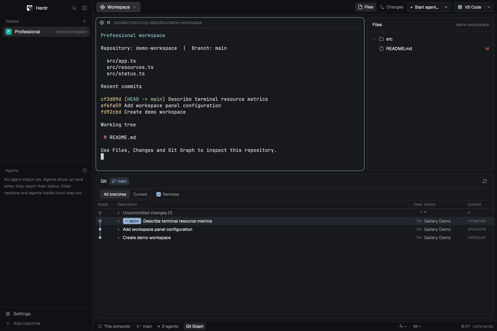

# oh-my-herdr

oh-my-herdr 0.4.0 is a complete workspace layout for Herdr Desktop: manage Spaces and Agents on the left, launch an Agent or open a repository in an editor at the top right, and view Git history and managed terminals' CPU and memory usage at the bottom. The layout combines eight independent Mods; it does not replace Herdr itself. It targets Herdr Desktop 0.1.15, with keyboard shortcuts written for macOS.



## What you see

The window uses Herdr's current theme. Its root is a horizontal layout with no system title bar. macOS window controls remain at the top left, and terminal panes have rounded borders.

- The left sidebar starts at 268 px wide and can collapse to 44 px. A 46 px native workspace title sits at the top, Spaces and Agents occupy the middle, and the bottom 69 px is reserved for Settings and Add machine. When OMP has an icon, the Agents list removes duplicate branding and known status prefixes from automatic titles, while preserving task text and manual names.
- The top-right tab bar is 42 px high. Workspace tabs are followed by Files, Changes, the Agent launcher, and Open With. Both launchers have a main button and a separate dropdown arrow; long names are truncated, with the full name shown on hover.
- The center shows the current tab's panes. Each 30 px pane header retains status, split, zoom, and close controls; diff pane titles use relative paths. Content padding and gaps between adjacent regions are both 8 px.
- Files and Changes share a right-side panel, initially 368 px wide, adjustable from 280 to 900 px, and hidden by default. Only one of the two pages is visible at a time.
- Git Graph is a separate bottom panel, initially 420 px high, adjustable from 240 to 800 px, and hidden by default. It can appear alongside the right-side Files / Changes panel.
- The 28 px bottom status bar shows the machine, branch, Agents summary, Git Graph entry, native command palette hint, and Task Manager CPU / memory readings at the far right. The command hint slot is 130 px wide; the resource slot is 188 px wide.

Task Manager opens upward from the bottom readings. Its maximum size is 416 px wide and 640 px high, further limited to 95% of the window width and 85% of its height. `Herdr / System` controls the scope of all three tabs, defaulting to Herdr each time the popup opens. Switching scope preserves the search and sort order; switching tabs preserves the scope. Herdr Tree groups processes by Space, Pane, and OS child process; System Tree groups them by machine and OS process hierarchy. Processes is a flat Name / PID / CPU / Memory table; Ports is a flat Endpoint / Process / PID table. Footer values use at most three digits, excluding decimal points, percent signs, and units: CPU below 100% uses one decimal place, and values too large for three integer digits use decimal abbreviations such as `k%`. Memory units scale by 1024, with decimal places adjusted as in `1.24 GB / 12.4 GB / 124 GB`. The popup retains detailed precision, and 100% CPU represents one core. Footer, summary, and table values use fixed-width slots, monospace text, and right alignment; changes in digit count or memory unit must not shift icons, separators, or adjacent columns.

## How it behaves

### Agents and launchers

Herdr provides working, blocked, done, and idle states. The Agents list preserves native grouping, pinning, priority, and trailing status indicators. The extension does not infer or override actual Agent state from titles. OMP title cleanup affects only the list display, not the terminal's original title.

The main launcher button and `⌘⇧A` use the current machine's default entry. With no default, they open the menu rather than automatically choosing an Agent. The right-hand arrow always opens only the menu.

- Clicking a program row creates a tab in the space, machine, and directory captured when the menu opened; it does not change the default.
- Clicking the trailing star only sets the default; it does not launch the program. The default and one custom command are stored separately for each machine, using an empty-string key for the local machine.
- Custom command edits the name, Program, and arguments as a JSON array of strings. Saving does not launch anything or implicitly evaluate pipelines, redirections, or variable expansion. To use a shell, the user must explicitly provide the shell and script arguments.
- Before launching the default, the launcher queries Herdr's program registry again. It reports an explicit error if the program is not installed, the original space has closed, or the machine is unavailable; it never silently switches machines or programs.
- The menu retains Terminal, New space, New worktree, and Open worktree. Use arrow keys to select, Enter to launch, D to set the default, and Esc to close.

The launcher does not install Agents, send an initial task, or manage terminal lifecycles itself. See the [README](README.md#configuration) for registering programs such as OMP that are not built in.

### Open With

Click the main button or press `⌘G` to open the current terminal's Git root in the default application, falling back to its cwd outside a Git repository. If the current terminal has no cwd, it queries a terminal directory in the current tab or the space directory. It does not follow the file selected in Files / Changes or open individual files.

The dropdown supports opening with an application once and setting the default with a star. Use arrow keys to select, Enter to open, D to set the default, and Esc to close. Setting the default does not launch an application.

Local macOS offers VS Code, Finder, Zed, IntelliJ IDEA, Cursor, and Sublime Text. Remote machines, Windows, and Linux offer only VS Code. Remote targets open through local VS Code Remote - SSH and require a working SSH Host; Core relay / via connections cannot be reused directly. The menu captures the target when opened, while the main button resolves the current target on every click. Users must install all applications themselves.

### Git Graph, Files, and Changes

Click the bottom Git Graph entry to toggle the panel. Drag its top edge to resize it. Select a commit to expand metadata and a file tree below its row; click again, press Esc, or use the detail close button to collapse it. Only one commit expands at a time, and the list and graph lines continue through the expanded area.

Single-clicking a changed file opens a shared read-only preview tab in the current space; clicking another file reuses it. Double-clicking pins the tab so later previews cannot replace it. Reopening the same machine, repository, commit, and file returns to an existing pinned tab. Each asynchronous read captures its target, and stale results must not overwrite a newer file. Uncommitted changes show the content read when the file was opened.

If a Git workspace has initialized submodules, the title menu lists `(root)` and recursive subrepositories identified by relative path. Selecting one changes only the Graph target, not the terminal cwd or right-side Changes target. Uninitialized submodules are not listed or automatically initialized, updated, or fetched. Non-Git directories use Manygit scanning.

`⌘⇧E` shows and focuses Files; if Files already has focus, it hides the panel. A single `⌘⇧G` waits 300 ms before toggling Changes; whether it hides the panel depends only on whether Changes is already visible. Two presses of `⌘⇧G` within 300 ms cancel the single-press action and toggle Git Graph, preserving the right-side panel state. Switching space, tab, or layout discards any pending single-press action.

Git Graph supports write and network operations such as commit, checkout, fetch, and push. Viewing history or a diff does not authorize these operations on the user's behalf.

### Resources and listening ports

The footer shows CPU and memory for managed terminals and their OS child processes; it is not a system-wide task manager. CPU at 100% represents one logical core and can exceed 100%. Memory uses footprint on macOS, RSS on Linux, and Working Set on Windows; shared pages may be counted more than once. Unknown values and incomplete coverage must be shown separately, never filled with zeros or given fabricated ownership.

While the application is active, CPU and memory are sampled every second, with requests deduplicated per machine. Sampling pauses when the application is inactive and rebuilds the CPU baseline on resume. Closing the popup leaves footer sampling active; only closing the corresponding View releases the sampling lifecycle. Identical displayed values do not force a redraw for each new sample. No fast redraw timer is used for animation here.

Type directly in the popup to search. Spaces separate terms, and all terms must match the same row or its ownership path. Search supports fields including name, machine, PID / PPID, CPU, and memory. Backspace deletes text; the first Esc clears the search and the second closes the popup. Arrow keys navigate, and Enter expands or collapses Tree nodes. Switching pages clears the search.

Tree shows listening ports by default, with no Ports toggle. Tree and Ports collect TCP listeners every 5 seconds for the current scope; search only filters results and does not implicitly expand collection to the whole machine. Processes does not collect ports, and closing the popup stops port scans. System collects system-wide CPU and memory only while the popup is open; closing it restores managed collection. The footer always shows Herdr-managed resources. The System summary totals readable processes and does not represent the host's used memory. Locating the current pane returns to Herdr Tree.

The collector is read-only: it does not elevate privileges, read argv, environment variables, or terminal content, retain sample history, terminate processes, or forward ports. Initial samples, PID reuse, counter rollback, excessive sampling intervals, and unreachable machines retain an unknown or error state.

## Built from

The repository root is a Gallery layout package: `layouts/oh-my-herdr.json`, `layouts/oh-my-herdr.svg`, `mods/`, this recipe, and `preview.png`. The SVG is a Herdr layout selector asset; the PNG is an actual UI screenshot for the Gallery. They serve different purposes.

| Mod | Layout role and responsibilities |
| --- | --- |
| `tabs-professional` | Tab bar, Files / Changes entries, default launcher button, and shortcut timing |
| `agent-launcher` | Launch menu and custom command editor |
| `agents-professional` | Agents list, preserving native status and removing duplicate OMP title prefixes |
| `professional-panels` | Native panels and focus handoff, with `props.child` set to `files` or `changes` |
| `open-with` | Top-right main launcher with `props.role: "launcher"`; application menu by default; `widthTarget` specifies the resizable slot |
| `professional-status` | Machine, branch, Agents summary, and Graph entry; `props.role: "hint"` provides the command palette hint |
| `git-graph` | Bottom history graph; `props.role` distinguishes pane headers, diffs, menus, dialogs, and settings |
| `resource-monitor` | Far-right footer readings and Task Manager, sharing snapshots deduplicated per machine |

The layout also references Herdr's built-in `workspace-chrome` and `spaces`, as well as built-in icon assets. Before installation, launch Herdr with the target application home; an empty directory is not a substitute for an initialized environment.

Mods read spaces, panes, terminals, agents, focused, theme, layout, and other data through `herdr`, and dispatch window commands through `run`. They use `exec` and `hc` for Git, program launches, Core queries, and the collection helper. GPUI controls are described with `gpui-kit` / `gpui-base`; there is no DOM, HTML/CSS, or Node.js API.

The resource collector source is in `native/resource-sample/`, with dependencies pinned in Cargo.lock. It uses libproc on macOS, procfs on Linux, and native process and TCP APIs on Windows. A build produces only the current platform's executable; remote machines require their own build of `herdr-resource-sample` on PATH.

See the [development guide](docs/development.md) for build, test, and real-application validation steps, and the [resource monitoring design](docs/design/resource-monitor.md) for the collection architecture and protocol.

### Installing the existing implementation

First read AGENTS.md and generated types in the target application home, this recipe, and the actual files. Explain program execution, network access, file reads and writes, and shortcut changes to the user. Do not assume the package is safe merely because it appears in the Gallery.

End users should use the release ZIP for their architecture on macOS 13.5+. It includes the official pinned Node.js 26.13.1, a prebuilt helper, and complete licenses; Node, Rust, Cargo, Git, and Xcode are not required for installation. Install into an initialized Herdr home, with `herdr-app` available in the terminal. Download the ZIP from [Releases](https://github.com/OiAnthony/oh-my-herdr/releases), verify `SHA256SUMS`, extract it, and run from the package root:

```sh
./install.sh --switch
```

Without `--switch`, installation does not switch layouts or restart the application. The ZIP is unsigned and not notarized, so macOS may block Node or the helper. After verifying the source, allow them manually through Privacy & Security; do not remove quarantine or disable Gatekeeper. Git features still require Git, and users must install editors and Agents themselves. If the version has not been published, maintainers must build the ZIP using the development guide; the Source code ZIP is not a release package.

Source developers still need Node.js and Cargo, plus Xcode Command Line Tools on macOS. Explicitly run `node scripts/build-resource-helper.mjs` before `./install.sh`. The installer does not compile or download dependencies, and a damaged ZIP does not fall back to global Node.

For a custom application directory, set `HERDR_APP_HOME` consistently for every command. The installer requires an existing, complete `keys.json`, merges [keybindings.json](keybindings.json) by binding, and records file hashes and original shortcut values in `.oh-my-herdr/installed.json`. It does not switch layouts or restart the application.

If a filename collides, a managed file has local changes, or a shortcut conflicts, stop and explain the issue to the user. Do not force an overwrite, delete ownership records, or rename the entire suite without permission. A manual rename requires updating all Mod paths, commands, and installer boundaries; renaming a folder is not enough. Do not let a separate community manager take ownership of the same files, as the two ownership records could overwrite each other.

After installation checks pass and the user agrees to change the current window layout, run:

```sh
herdr-app do layout.switch '{"name":"oh-my-herdr"}'
```

To update, download the new ZIP and run `./install.sh` from its newly extracted directory. Before uninstalling, switch back to a built-in layout and close the suite's panes, then run `./install.sh --uninstall` from the package directory. Updates, checks, and uninstalls all use private Node and do not require system Node. They continue to use `.oh-my-herdr/installed.json`, restore unmodified managed shortcuts, and preserve personal configuration and state. See the [README](README.md) for the full commands.

To rebuild from an empty directory, implement eight independent Mods using the layout tree and responsibilities above; copying the installer's internal structure is not required. Preserve shortcut conflict protection, explicit installation and activation boundaries, accurate resource accounting, and third-party source and license notices.

## Watch out

- Mods are trusted code, not sandboxed. This suite can execute Git, open local applications, initiate SSH connections through VS Code, and launch user-specified programs. Personal shared state is stored in plaintext and is unsuitable for secrets.
- `⌘W` changes from closing a tab to closing the current pane, terminating its terminal. Closing the last pane also closes the tab. The previous close-pane binding on `⌘⇧W` is removed. `⌘T` and native `⌘⇧P` are retained.
- `keybindings.json` contains installer rules; it is not a `keys.json` that can directly overwrite Herdr configuration. Existing matching bindings must not be replaced without consent. The installer has no force option.
- Native helper build outputs are not committed to Git. A source checkout requires an explicit build first; a release ZIP must include a helper matching its architecture. Missing or damaged helpers fail before configuration is written, with no on-site compilation or fallback sampling through `ps`, `top`, `lsof`, or PowerShell.
- Deployment is one-way from source to application home. Do not copy personal `apps.json`, `hosts.json`, shared state, data, window information, or sessions into the repository.
- The adapters originate from built-in 0.1.14 copies; the target runtime is Desktop 0.1.15. When upgrading the host, compare current types with these copies rather than assuming older versions support new APIs.
- Commit details are retained child views. Do not register events in deferred row renderers or reuse element objects created by an outer render across element descriptions.
- Linux / Windows resource collection has not completed target-platform runtime acceptance, and Remote - SSH has not completed end-to-end acceptance. Some physical-input, sorting, and scrolling interactions in the macOS resource popup still need acceptance; `herdr-app check` is not a substitute.
- The release build matrix is macOS arm64 (`macos-15`) and x64 (`macos-15-intel`). Local arm64 validation does not establish acceptance on Intel, a clean Mac without CLT, or the Gatekeeper path after a browser download.
- Original project code is Apache-2.0. See [NOTICE](NOTICE), [THIRD_PARTY.md](THIRD_PARTY.md), and each Mod's license files for exceptions covering third-party code, icons, and native dependencies; retain them when distributing. VS Code, Finder, Zed, and IntelliJ IDEA use neutral icons. Application names do not imply vendor endorsement; do not repackage local application icons without establishing redistribution rights.

## Done when

- In an initialized isolated app home and a separate Core session, build the helper from clean source and actually complete install, check, and uninstall; all eight Mods load initially. Uninstall restores shortcuts and preserves personal configuration.
- The native window shows oh-my-herdr's sidebar, tab bar, two launchers, and status bar. Files / Changes appear on the right and Graph at the bottom; both can be visible together, with no load errors.
- Clicking an Agent row launches only once; starring and saving commands do not launch. The main button and `⌘⇧A` each create only one tab. Defaults remain isolated when switching machines, and invalid targets produce explicit errors.
- Setting the Open With default does not open an application. Launching uses the correct repository and machine, never handing a remote directory to an ordinary local application. Failures produce explicit messages.
- Graph can expand, collapse, and switch commits. Single-clicking files reuses the preview; double-clicking pins it, and pinned tabs are not replaced. Switching subrepositories does not change terminal cwd or the Changes target.
- Files focus and hiding, the single-press Changes toggle, and the double-press Graph toggle follow the 300 ms rule. Context changes prevent stale pending commands from running.
- All three Task Manager pages show real samples. Search, sorting, arrow keys, Enter, and Esc work as described above. Tree displays and searches listening ports by default; Processes and a closed popup do not scan ports, while footer sampling continues. Changes in digit count, unknown values, and memory units do not cause horizontal layout shifts.
- Inspect the layout using actual application screenshots. Do not present simulated host callbacks, successful initial loading, or test assertions as evidence of real mouse, keyboard, or remote acceptance.
