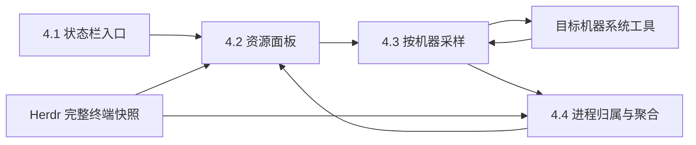

# oh-my-herdr 资源监控实施方案

日期：2026-11-11  
状态：源码已实现，模型/解析/安装器及本机采集验证通过；真实 UI 与跨平台运行验收未完成  
目标版本：Herdr Desktop 0.1.14、Core 0.1.19  
实施位置：`desktop/extensions/oh-my-herdr/`

## 1. 结论与约束

**新增独立 `resource-monitor` Mod，通过现有终端 PID、系统进程表和监听 socket，展示 Agent 资源、子进程与服务端口。** 状态栏提供入口，不修改 Herdr Desktop/Core 本体，不引入常驻服务或原生 helper。

本文供实现者开发与验收使用。设计依据来自 Orca 分析和本机命令验证；实现验证记录见第 12 节。开发、隔离验证、安装到日常环境是三个不同动作。本方案不授权安装到日常应用、切换当前布局、结束用户进程或重启 Core。

当前仓库约束：各 Mod 独立维护，不引入统一路由器或跨 Mod shared 包。`professional-status` 只负责入口，采样与资源归属均由新 Mod 管理。

## 2. 功能范围

**默认以 Space → Tab → Pane → Terminal/Agent → OS 进程树展示全部 Spaces。** 当前 Space 置顶展开，其他 Spaces 初始折叠；远端 Space 带机器名前缀。同一 Agent 内部通过普通子进程启动的工具和服务，也属于统计范围。

| 能力 | 交付行为 |
| --- | --- |
| 资源列表 | CPU、内存及口径、全部后代数、监听端点数，可按名称、CPU、内存排序 |
| 进程明细 | 展示程序名、PID、PPID、CPU、内存，标记终端根进程与当前前台进程 |
| 子进程计数 | 分别显示直接子进程数和全部后代数，均不包含根进程 |
| 监听端口 | 展示归属进程、TCP LISTEN 的地址、端口、IPv4/IPv6 和绑定范围 |
| 趋势 | 每个终端及上层分组最多保留 60 个内存样本 |
| 主机信息 | 展示各机器可用内存口径的主机使用率，与受管进程资源总和分开 |
| 远端 | 在资源所属机器采集，所有身份携带 machine，不将远端端口当本机端口 |
| 异常状态 | 区分无进程、无监听、未采样、部分可见、失败、离线及过期数据 |

平台目标包括本机 macOS，以及 Herdr 已连接的 macOS、Linux、Windows 机器。三者共用归属和 UI，各自实现采样适配。只有 macOS 的 PID、RSS、监听端口和主机内存命令已在本轮实测。Linux/Windows 是实施目标，不能在完成对应验收前宣称已验证支持。

以下内容明确不做：

- 不主动探测 HTTP/HTTPS，不根据 3000、5173 等端口号断言 Web 框架或协议。
- 不自动打开浏览器，不增加端口转发，不测试外部网络可达性。
- 不接入 Docker/Kubernetes，不推导容器内端口和宿主发布端口的完整映射。
- 不扫描或展示与 Herdr 无关的全机进程清单。系统级扫描只在内存中用于关联。
- 不读取进程环境变量，不展示完整 argv，不上传资源数据。
- 不新增结束进程或结束终端按钮。Orca 的确认后结束功能只作参考，不属于本次只读监控需求。
- 不保证追踪已 daemonize、被重新托管或脱离原始进程树的服务。
- 不复制 Electron 的 Main/Renderer/Other 分桶。Herdr 是原生客户端，不能把 Core 整棵进程树当成应用自身开销。

## 3. 技术取舍

**采用 Mod 按需执行系统命令，承担系统工具差异，但避免新服务的安装与生命周期管理。**

| 决策 | 选用方案 | 未选方案及代价 |
| --- | --- | --- |
| 数据采集 | `herdr.exec` 定向到 machine，批量读取系统信息 | 常驻 daemon 可降低启动开销，但增加部署、协议、启停和升级责任 |
| 终端身份 | 直接消费 `terminals()` 的 Core 完整快照 | 高频逐个 `hc get` 会随终端数增加 CLI/RPC 次数，不作为正常采样路径 |
| macOS 内存 | RSS 始终可展示，低频 `top` 补充 footprint | 原生 `proc_pid_rusage` helper 更轻，但增加语言、构建及二进制分发，不引入 |
| CPU | Unix 使用 `ps %CPU`，Windows 使用累计 CPU 时间差值 | 全平台统一严格窗口 CPU 需要额外采集机制，不冒充已实现 |
| 资源归属 | OS PID/PPID 建树，遇到另一个受管终端根 PID 时切分归属 | 仅凭进程名/cwd 容易误认，按注册顺序抢占重叠树会使归属依赖顺序 |
| 服务识别 | 只展示已监听的 TCP 端点 | HTTP 探测会产生网络请求，按端口号猜服务会误报 |
| 界面 | 状态栏入口打开非持久资源浮动面板 | 常驻侧栏占用布局空间，关闭时仍刷新的状态栏数值会产生持续采集成本 |
| 状态保存 | 当前面板内存状态 | 持久化采样无助于短时诊断，还会保存进程和端口信息 |

最可能改变采集方案的因素是目标机器上系统工具的实际成本。若后述性能验收不满足，本方案不以提高并发或偷偷启动 daemon 补偿，应重新评审采样频率或 helper 路线。

## 4. 数据流与模块边界

**所有资源数据由一个面板实例拥有，关闭实例即停止后续采样。**



### 4.1 状态栏只提供入口

修改 `mods/professional-status/main.js`，在 Git Graph 后增加 Resources 文字按钮。保留已有机器、分支、Agent 数量和最右侧命令面板提示。

按钮通过 `openOverlay` 打开 `resource-monitor`，使用 `kind: "window"`、固定 `key: "resource-monitor"`、`keep: false`。固定 key 保证重复点击不叠加实例。宽高分别使用视口的 80% 和 75%，内容在面板内滚动。此处是应用内浮动面板，不创建 OS 窗口，也不修改 Professional layout 文件。

输入是点击事件，输出是面板实例。不在状态栏中执行采样，不创建持续跳动的 CPU/内存徽标，不增加全局快捷键。

### 4.2 面板拥有采样生命周期和交互状态

`mods/resource-monitor/main.js` 管理筛选、排序、展开项、采样调度和异步结果。按现有 `View`、`cx.spawn`、`cx.timer` 模式实现，渲染与虚拟行回调中不执行系统命令。

默认展示全部 Spaces，不提供当前/全部范围开关。当前 Space 置顶，展开到 Tab、Pane 和 Terminal/Agent；其他 Spaces 初始折叠。当前 Space 变化后，新 Space 置顶并展开。有 pane 的终端位于对应 Pane 下，无 pane 的子终端位于同 tab 的逻辑父终端下；跨 tab 的显式归属不因 parent 改变。逻辑父子关系只影响展示，上层分组仍按进程身份去重，终端自身资源仍按 OS PPID 独立计量。未归入已知 space/tab 的记录放到该机器的未归属分组，不伪造关联。

顶部使用紧凑工具栏，刷新间隔选项为 1s、2s、5s、10s，默认 5s。选择后替换当前定时器，不叠加，也不持久化选项。不显示固定刷新提示和跳动的采样状态，采样时间保留在悬停提示。面板保留手动刷新、关闭、Esc、名称筛选与内存/CPU/名称排序；当前 Space 不参与其他 Spaces 的排序，始终置顶。长列表使用原生虚拟列表，颜色来自 `theme()`。

### 4.3 采样模块只产生标准化机器快照

`mods/resource-monitor/collect.js` 接收 machine、目标终端及平台适配信息，返回进程、监听端点、主机内存、各项采样时间与错误。不负责 space/tab 分组，不拼接 UI 文案，不写持久状态。

本机平台使用 `window().platform`。远端不能沿用本机平台：首次采样进行固定只读平台探测，Unix 用 `uname -s`，Windows 用 PowerShell 获取平台信息。只有明确属于工具缺失或平台不匹配时才尝试另一种探测，连接失败直接报错。探测结果缓存到本次连接结束，重连后重新识别。

每台机器每项命令只执行一次，处理所有目标 PID。使用程序和参数数组调用 `exec`，不把终端名称、cwd、端口或 argv 插入 shell 脚本。需要多行固定 PowerShell 脚本时，脚本作为固定资源随 Mod 分发或固定字符串传入，不包含用户可控脚本片段。

### 4.4 模型模块负责身份、树、端点与聚合

`mods/resource-monitor/model.js` 接收标准化快照及 Herdr 归属信息，输出可展示的分组和明细。该模块不依赖 GPUI，不执行命令，可在 Node 测试中验证消费者可见的归属、去重和未知值传播。

禁止将 `Terminal.parent` 当作 OS PPID。前者用于 Herdr 子终端的 tab 归属，后者用于 OS 进程树。

## 5. 采样契约

**进程与端口每 2 秒更新，主机内存和 macOS footprint 最快每 10 秒更新。** 这些频率是本方案决定，不是已测性能承诺。

| 平台 | 进程资源与树 | TCP 监听 | 主机内存 | 附加内存口径 |
| --- | --- | --- | --- | --- |
| macOS | `ps` 批量读取 PID、PPID、%CPU、RSS、程序名、进程启动时间 | `/usr/sbin/lsof -nP -iTCP -sTCP:LISTEN`，使用可解析字段格式 | `memory_pressure -Q` | `/usr/bin/top -l 1 -stats pid,mem`，最多每 10 秒一次 |
| Linux | `ps` 批量读取相同语义字段 | `ss -H -ltnp` | `/proc/meminfo` 的 MemTotal、MemAvailable | 无，不执行昂贵的逐 PID PSS/USS 扫描 |
| Windows | PowerShell/CIM 批量读取 PID、PPID、CreationDate、WorkingSetSize、累计 CPU 时间、程序名 | `Get-NetTCPConnection -State Listen` 的 OwningProcess | `Win32_OperatingSystem` 的总量与可用物理内存 | 不增加 private bytes 列，本次保留 Working Set |

Unix 命令固定 `LC_ALL=C` 和 `LANG=C`，处理小数点及日期解析。RSS 转成 bytes，Windows Working Set 保持 bytes。所有内存展示采用 KiB、MiB、GiB，不将十进制单位写成二进制数值。

`lsof` 保留 socket 标识、地址族和数值地址所需字段，禁止反向 DNS 和服务名解析。Linux 的 `ss` 与 Windows cmdlet 可能受权限限制，这类快照必须声明覆盖范围，不能把看不到进程归属解释为没有监听。

不安装缺少的工具，不要求 sudo，不添加与 Orca 相同的 `typeperf` 重试机制。某项命令不可用只影响对应能力，不丢掉同机已成功的其他数据。

### 5.1 调度与超时

| 条件 | 行为 |
| --- | --- |
| 面板打开且应用活跃 | 立即采样，之后按所选 1/2/5/10 秒间隔调度，默认 5 秒 |
| `window().active` 为 false | 不启动新系统命令，已有数据保留，采样时间可悬停查看 |
| 应用恢复活跃 | 下一次调度立即采样，不补跑错过的轮次 |
| 同机已有采样在进行 | 跳过本次，不排队，不重叠 |
| 多台机器 | 最多并发采样 2 台，各机器独立成功或失败 |
| 手动刷新 | 使用同一进行中请求，不新增并行扫描 |
| 面板关闭、热重载 | 取消调度，增加 generation，忽略旧结果，不等待外部命令结束 |
| 终端根 PID 或机器连接变化 | 清理旧身份缓存及对应趋势，再按新身份采集 |

`window().active` 表示应用是否活跃，不等于完整的窗口可见性 API。本方案比 Orca 更保守，应用失去焦点就暂停系统采集，不声称能区分被遮挡和最小化。

单命令 timeout 为 5 秒，利用 `exec` 既有输出上限。任一必需进程表命令失败、截断或无法解析，不能发布为完整零值快照。失败后不立即重试，只在下一正常采样时机恢复。关闭后已启动的命令可能运行到结束或超时，generation 保证其结果不回写。

### 5.2 CPU 与内存不能混用口径

CPU 按一个逻辑核心为 100% 显示，多核进程可超过 100%。Unix 的 `ps %CPU` 是系统工具定义的统计值，刷新间隔不表示严格 CPU 窗口。Windows 使用相邻快照累计 CPU 时间差除以真实时间间隔，首个样本和身份变化时显示未知。进程样本与 Windows CPU 间隔的有效期为 `max(10000, 所选间隔毫秒数 + 5000)`，容纳 10s 档位的采集耗时；超过有效期则标记过期或未知。

macOS/Linux 的主内存列固定显示 RSS，Windows 固定显示 Working Set。内存排序和趋势始终使用这列，不在不同终端间混用 RSS 与 footprint。macOS 的进程明细及分组详情额外显示 Footprint 和该数据的年龄。只有有效样本覆盖整组参与求和的进程时，才显示组 Footprint。任何进程缺少样本、身份无法对上或数据超过 15 秒，该项显示未知，RSS 仍正常展示。

趋势以对象身份和主内存口径为键。口径变化或进程重建时重新开始，不把两种数值连成同一条曲线。RSS/Working Set 之和可能重复共享页，不代表独占物理内存。主机可用内存采样失败时，该指标显示未知，不用进程总和或 Unix free pages 冒充可用内存。

## 6. 身份与资源归属

**统计单位是带机器身份的进程，CPU、内存与计数均不能重复求和。**

| 记录 | 必要字段与语义 |
| --- | --- |
| 终端身份 | machine、address、根 PID、已观察到的进程启动时间 |
| 进程 | machine、PID、PPID、启动时间或其不可用状态、程序名、CPU、RSS/Working Set、可选 footprint、采样时间 |
| 监听端点 | machine、PID、地址族、TCP、本地地址、端口、采样时间 |
| 能力状态 | 每项独立的 ready、partial、unavailable、error，以及原因和时间 |
| 聚合结果 | 计入的唯一 PID 集、未知成员数、直接子进程数、全部后代数、唯一监听端点集 |

归属步骤如下：

1. 从 `terminals()` 构造同机受管终端根 PID 集，筛选 live 记录。缺少 PID 时显示等待进程信息，不退到按名称匹配或逐终端高频 `hc get`。
2. 用 OS PPID 建树。每个根进程向下遍历，遇到另一个受管终端根 PID 时停止，将其子树交给那个终端独立统计。
3. 进程树遍历带 visited 集，处理异常环和重复记录。终端共享同一根 PID 时只计一次，冲突终端标记归属不明确，不按数组顺序决定所有者。
4. 根据终端标签、pane 和逻辑 parent 关联 space/tab，逻辑 parent 遍历同样防环。父 Agent 行不再把子终端资源作为自己的直接资源重复加入，上层分组以 PID 集合并求和。
5. 监听记录按 machine 和 PID 关联到具体进程，再聚合到终端与上层分组。
6. 未出现在进程表、已退出、身份发生变化的进程不认领资源。PID 重用依靠启动时间识别，不沿用上次历史。无法确认身份时声明不确定，不保证完全消除采样间竞态。

子进程数量采用可观察语义：直接数是根 PID 的 OS 子进程数量，后代数是完整 OS 后代集合大小。独立子终端若恰好位于其中，可以出现在后代计数中，但资源归属在另一个终端根处切分。UI 说明计数是树结构，资源是去重后的归属，二者不能互相推算。

进程表与 socket 表不是原子快照。只关联本轮存在且身份可确认的 PID，端口记录标注自身采样时间。开始和结束之间退出或重用的 PID 可能导致漏报，不把瞬时扫描包装成绝对准确的审计记录。

## 7. 端口展示不推断 Web 服务

**功能名称使用“子进程与监听端口”，只表达已观察到的事实。**

每条监听记录展示程序名、PID、本地地址、端口和 TCP LISTEN。`127.0.0.0/8` 与 `::1` 标为仅回环绑定，`0.0.0.0`、`::` 或工具输出的通配地址标为所有接口，其余标为指定地址。不将所有接口绑定写成公网可达。

唯一端点键为 machine、PID、地址族、协议、地址、端口，同一 socket 的重复文件描述符不重复计数。同端口的 IPv4/IPv6 端点分别保留，因此字段叫监听端点数，不叫 Web 服务数量。共享 socket 涉及多个 PID 时，各进程可显示关联，但上层对明确同一 socket 做去重，无法证明相同时不强行合并。

没有监听端点只表示当前快照未发现该终端树内的 TCP LISTEN，不表示 Agent 没启动过服务。HTTP、HTTPS、数据库、自定义协议都使用同一种端点展示。不增加 HTTP 标识、框架 logo 或自动请求。

对于远端 `127.0.0.1:3000`，地址旁明确显示机器名，不生成本地 localhost 链接。容器发布端口或脱离进程树的服务不认领给 Agent。

## 8. 界面状态与安全

**未知值不能展示成零，失败项不能覆盖已经成功的其他指标。**

| 情况 | 显示 |
| --- | --- |
| 首次采样 | 加载状态，不预填 0 |
| 成功且无终端 | 当前范围没有运行中的终端 |
| 成功且没有监听 | 没有发现 TCP 监听端点 |
| 端口工具缺失 | 端口采集不可用，CPU/内存仍显示 |
| 权限限制 | 端口归属可能不完整，不能显示确定的 0 |
| 刷新失败但有旧数据 | 保留旧值，明确过期时间和失败原因，不追加趋势样本 |
| 远端离线 | 该机器资源未知，不将上次数据计入实时完整总数 |
| 部分成员未知 | 分组显示已知小计及未知成员数，不标成完整总量 |
| 用户筛选列表 | 分组原始总量不变，明确筛选只作用于显示 |

系统命令沿用用户现有权限，不提权。默认程序名来自进程可执行名称，不读取或记录 argv、环境变量、终端内容。错误信息展示时去掉完整命令回显及可能包含的敏感参数。

趋势、进程列表、端口、排序和折叠状态仅保存在面板实例内，不写 shared state，不产生网络请求或遥测。关闭后释放。无需 API key、账号、权限弹窗或额外端口。

## 9. 文件变更与交付顺序

**该功能涉及超过 8 个文件，但只新增一个独立 Mod，不新增服务。** 不改上游仓库和现有其他功能 Mod。

| 文件 | 变更 |
| --- | --- |
| `mods/resource-monitor/main.js` | 新建原生面板、交互和采样生命周期 |
| `mods/resource-monitor/model.js` | 新建身份、树、归属、聚合与端点去重逻辑 |
| `mods/resource-monitor/collect.js` | 新建三平台采样与结果标准化 |
| `mods/resource-monitor/mod.json` | 新建 metadata，`place: "none"`，标题 Resources |
| `mods/professional-status/main.js` | 新增 Resources 入口，不承担采样 |
| `oh-my-herdr.json` | 注册 resource-monitor，沿用发布版本规则更新套件版本 |
| `oh-my-herdr.mjs` | 将 resource-monitor 加入 `MODS`，使安装器归属和校验覆盖新组件 |
| `resource-monitor.test.mjs` | 新增归属、计量和边界回归测试 |
| `oh-my-herdr.test.mjs` | 更新 fixture 中的完整组件清单，复用已有安装与卸载行为测试 |
| `README.md` | 补组件、使用方式、平台依赖和指标限制 |
| `CHANGELOG.md` | 实现完成后记录功能，不提前写已发布 |

`Professional.json`、预览 SVG、`keybindings.json` 无需改变。独立浮动面板不改变现有 Files、Changes 和 Git Graph 的布局。

按以下顺序开发，作为一个完整功能交付，不把内部步骤称为可发布版本：

1. 在隔离目标读取运行版声明，确认 `terminals()` 中的 PID/foreground 与快照更新。若目标版本缺少必要字段，报不支持并重新评审，不通过高频补查掩盖契约差异。
2. 实现三平台采样和模型，固定上述计数、口径、去重与未知值语义。
3. 实现面板、状态栏入口及关闭后停止采样，处理热重载和迟到响应。
4. 接入 manifest、安装器及现有安装测试，完成行为验证后更新 README/CHANGELOG。
5. 在隔离应用中完成真实 UI 和运行验收。向用户交付源码、验证结果和部署方法，不自动安装到日常应用。

## 10. 验收与性能预算

**命令通路已验证，最终功能仍须经过模型测试、真实场景和原生 UI 三类验收。**

永久测试只覆盖消费者可见的不变量，不新增源码文本、导入转发、字段照抄或 UI 文案精确匹配测试。用固定数据验证：跨机器同 PID 不混淆，嵌套终端不重复计量，逻辑 parent 与 OS PPID 不混用，异常环不会死循环，PID 重用清空历史，端点重复/双栈规则，未知值不变零，RSS 与 footprint 不混合。

动态采集与 UI 使用可删除的隔离场景验证，不为平台命令转发增加 mock 回声测试。

| 验收场景 | 通过条件 |
| --- | --- |
| 一个终端启动子进程和孙进程 | 直接数、后代数与 OS 快照一致，资源包含后代 |
| 两个 Agent 各自启动监听服务 | 各端口归属正确，不按服务名或相同 cwd 混组 |
| 一次 OS 树包含另一受管终端根 | 上层每 PID 只计一次，两个终端身份稳定 |
| 只绑定回环与通配地址 | 分别标记绑定范围，不声称公网可达 |
| IPv4/IPv6、重复 FD、共享 socket | 按第 7 节口径显示和去重 |
| 服务退出或端口重启 | 下一次成功扫描移除旧监听，不保留为运行中 |
| 新进程无 footprint 或 footprint 过期 | 正确显示 RSS 与口径，不混接趋势 |
| 远端与本机使用相同 PID/端口 | 按机器隔离，不生成远端 localhost 的本地访问入口 |
| 缺少工具、权限不足或远端断开 | 对应项明确未知，其他成功项保留 |
| 慢命令、手动刷新、重复点击入口 | 同机无重叠扫描、无任务积压、只有一个资源面板 |
| 关闭后命令返回、热重载、应用失活 | 旧结果不回写，关闭后不再启动命令，失活期间不采集 |
| 重新打开面板 | 新实例可正常采样，不保留旧进程身份或无限增长的趋势缓存 |

隔离验证命令从扩展目录执行：

```sh
node --test resource-monitor.test.mjs oh-my-herdr.test.mjs
HERDR_APP_HOME=/private/var/tmp/oh-my-herdr-resource-check herdr-app check mods/resource-monitor
```

真实 UI 验证需使用初始化完成的独立 app home，以及独立 `HC_SESSION`/Core 状态目录。部署检查使用现有安装器的显式目标目录参数。不得复用日常 Core 会话启动测试服务，也不得自动打开日常应用执行 layout.switch。

`herdr-app check` 只证明初始加载，不覆盖后续采样和延迟行。真实应用验收包含展开、排序、长列表、Esc、关闭重开、主题和窄窗口，并记录 `.error` 状态。Linux/Windows 适配分别在对应机器运行同类服务场景；未执行的平台单独标为未验证。

以下预算仍作为验收目标；已取得的本机测量与未测项目见第 12 节：

- 以 50 个受管终端、500 个关联进程、100 个监听端点作为常规样本。每机同项命令次数不随终端数增长。
- macOS/Linux 本机普通进程与端口采集连续 20 次的 p95 不超过 500 ms。Windows 不超过 1.5 秒。远端另记网络时间，不把网络慢解释为本机采样成本。
- footprint 单独记耗时和年龄，不要求它每 2 秒完成。若 5 秒内不能返回，按已定义的 RSS 口径展示并说明不可用。
- 关闭后除已发出的有界命令外，60 秒观察期内新增采集为 0。重开 20 次后无遗留 timer 或重复采集。
- 进程索引、归属与聚合按 PID/PPID 一次建索引处理，不对每个终端重复扫描全部进程。趋势按对象最多 60 点，实例关闭即释放。

## 11. 部署与回滚

**实现授权不等于部署授权。** 完成后先交付验证记录，再由明确授权决定是否运行现有 `install`/`check`。

正式安装沿用 `oh-my-herdr.mjs` 的所有权记录、备份和冲突检查，不新增第二套复制脚本。安装器不会切换布局，但会写入运行目录并可能触发热加载，所以仍需独立授权。用户修改过的目标文件冲突必须保留，不强制覆盖。

回滚优先恢复安装器此次变更的受管文件及匹配的所有权记录，包括状态栏、manifest 对应组件和新 Mod。只处理此次部署范围，不恢复整个 app home，不碰 settings、shared state、窗口位置和其他个人文件。整套 `uninstall` 会卸载已有功能，不能当成本功能回滚。保留新 Mod 但移除入口只能临时止损，不算完成回滚。

无数据库、采样持久文件、远端 agent 或服务需要迁移。回滚不结束终端、不关闭测试以外的监听服务、不重启 Core。

## 12. 证据、差异与剩余验证

**源码与本机采集已有验证，不能宣布真实 UI 或跨平台验收完成。**

本轮已实际执行：

- `herdr-app --version` 为 0.1.14，`hc --version` 为 0.1.19。
- `hc get` 取得终端根 PID 与前台 OMP PID，`ps` 验证父子关系并聚合 CPU/RSS。
- 同一终端的样本观察到 1 个直接子进程和 4 个后代，`lsof` 能将回环监听关联到其中的 OMP PID。计数和端口是瞬时样本，不是固定预期值。
- `memory_pressure -Q` 能返回本机主机内存信息。

当前源码证据：

以下源码路径均相对工作区根目录。

- `desktop/herdr-app/src/hc.rs:56-76` 保留 event snapshot 的完整 terminal 记录。
- `desktop/herdr-app/src/window.rs:2007-2028` 仅标准化 status/program/report/title，再发布给 Mods，不裁掉 PID。
- `desktop/herdr-app/src/mods.rs:609-610,1043` 发布及读取 `terminals()`。
- `core/herdr-core/crates/herdr-core/src/cli.rs:423-427` 说明 `hc ls` 的短字段来自 CLI 投影，不能据此推断 Desktop 没有 PID。
- 当前安装目录的 `herdr.d.ts` 提供 `exec`、`terminals`、`window`、`openOverlay`，`gpui-kit.d.ts` 提供原生 timer/task。
- `oh-my-herdr.mjs:12,139-188` 的组件白名单及完整性检查要求同时更新 manifest 与安装器，不是只新增 Mod 目录。

Orca 参考固定到 commit `12e809c7556e49bb513b9f009695a9523c088a9e`：

- [collector.ts](https://github.com/stablyai/orca/blob/12e809c7556e49bb513b9f009695a9523c088a9e/src/main/memory/collector.ts)：进程批采样、PTY 子树聚合、进行中请求合并。
- [process-index.ts](https://github.com/stablyai/orca/blob/12e809c7556e49bb513b9f009695a9523c088a9e/src/main/memory/process-index.ts)：PID/PPID 索引、子树遍历、footprint 替换。
- [darwin-process-footprint.ts](https://github.com/stablyai/orca/blob/12e809c7556e49bb513b9f009695a9523c088a9e/src/main/memory/darwin-process-footprint.ts)：原生 helper 及 10 秒缓存的 top 回退。
- [use-resource-usage-status-controller.ts](https://github.com/stablyai/orca/blob/12e809c7556e49bb513b9f009695a9523c088a9e/src/renderer/src/components/status-bar/use-resource-usage-status-controller.ts)：2 秒刷新与视图激活条件。
- [process-stats-types.ts](https://github.com/stablyai/orca/blob/12e809c7556e49bb513b9f009695a9523c088a9e/src/shared/process-stats-types.ts)：CPU 单位与内存指标含义。

相较 Orca，本方案保留按需采样、可靠身份、去重与指标标注，但不用它的 Electron IPC、原生 helper、kill、注册顺序归属或复杂 PTY inventory。应用失活即暂停采样，macOS footprint 更新更慢，CPU 统计也不承诺跨平台完全相同。

2026-11-11 实现验证：

- `resource-monitor.test.mjs` 与安装器测试共 78 项通过；包含模型、Unix/Windows 解析、CPU 时间差、Footprint、未知值和身份变化边界。
- 新 Mod 初始 `herdr-app check` 通过；临时自包含原生 fixture 的 50 个终端、500 个进程、端口行和趋势 PathBuilder 描述通过检查；状态栏入口检查通过。
- macOS 真实父子进程和两组监听场景验证通过，覆盖归属、回环/通配绑定、退出后移除。20 次普通采样 p95 为 60 ms，首次 `top` 为 1542 ms。该次进程快照有 888 条记录，主机和 Footprint 状态 ready；监听保守标为部分可见。
- 隔离应用打开 Resources，`status.errors` 为空。系统截图报告没有活动显示器，应用原生截图仍是旧帧；不能据此确认新面板视觉、点击、Esc、主题或窄窗口行为。
- 可删除的 Node 生命周期场景通过：同机合并、失活暂停、身份变化/关闭后的迟到结果隔离；重开 20 次剩余 timer 为 0，关闭后 60 秒新增采样为 0。调度/宿主边界为测试实现，不冒充真实窗口交互。
- Linux/Windows 及远端运行、50 终端/500 进程/100 端点完整性能场景未验收。没有改动上游源码或日常运行目录。

2026-11-11 需求调整验证（Herdr Desktop 0.1.15）：

- 资源模型与解析测试 16 项通过，覆盖显式 Pane 优先、无 Pane 子 Agent、跨机器身份、分组不重复计量，以及 10s 档位的 Windows CPU 时间差。
- `herdr-app check mods/resource-monitor` 通过。可删除的 Node 场景执行实际面板回调，验证全部 Spaces 默认可见、当前 Space 跨机器置顶及切换展开、进程展开、四档定时器替换、失活暂停和关闭释放；原生宿主边界为测试实现。
- 独立 app home 中渲染原生面板，核对全部 Spaces、当前 Space 置顶、Pane/Agent 层级，以及 600×380 面板的四档刷新菜单和横向滚动表格。应用 `status.errors` 为空。截图检查不等于真实鼠标、键盘或滚动交互验收；Linux/Windows 与远端端到端验证仍未完成。
- 未部署到日常 app home，未切换日常布局或重启现有服务。临时应用与验证脚本在验证后清理。

实现细节差异：Linux 使用 `ss -H -ltnpe` 多取 inode 以识别共享 socket；失败终端保留 stale 旧值，上层实时小计排除失败资源；macOS lsof 一律标为权限范围内的部分可见。发布前仍需补齐上述未完成的运行与 UI 验收。
